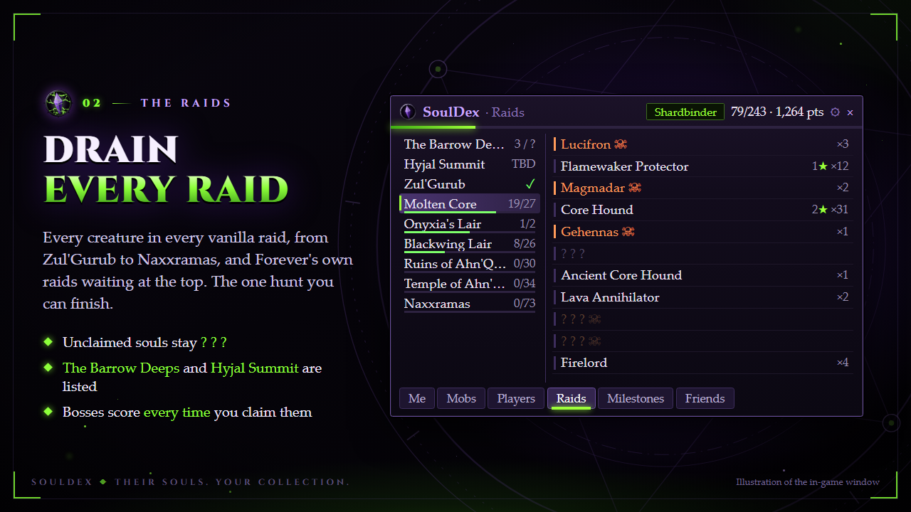
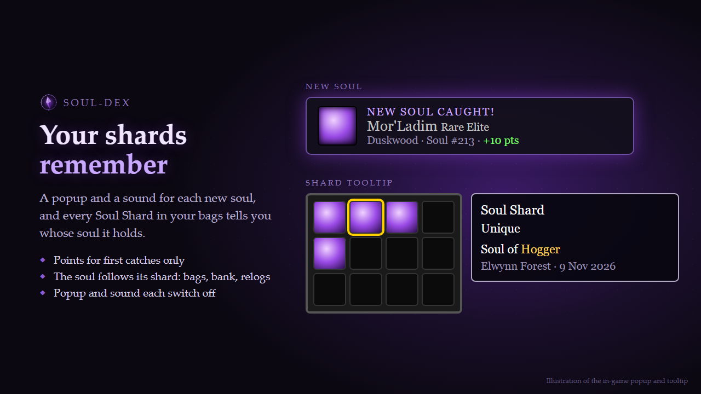
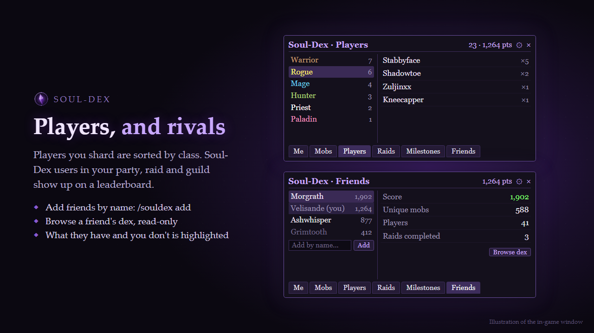

  

  
  
  
  

# SoulDex

**A collection dex for your Soul Shards.** A World of Warcraft: Forever addon for
warlocks: every time a Soul Shard lands in your bags, the mob or player it came
from is *caught* and recorded in your dex. Collect them, earn points and
milestones, and compare with other SoulDex users.

Type `/souldex` or `/dex` in game to open it.

## Features

### ◆ Mobs: every shard is a soul caught

Every creature you've drained, grouped by zone and dungeon, in its rarity colour.
Click any soul for its level and type, a flavour line, how many times you caught
it, and when and where you caught it first.

### ◆ Raids: the one collection you can finish

A fixed list of every creature in every vanilla raid, from Zul'Gurub to
Naxxramas. Uncaught souls show as `? ? ?`, and bosses are marked before you
catch them.

### ◆ Your shards remember

Hover a Soul Shard in your bags and its tooltip names the soul inside, with where
and when you took it. The soul follows its shard through bags, the bank and relogs.

### ◆ Players, and rivals

Every player you've sharded, grouped by class. **Friends** is a leaderboard of
SoulDex users in your party, raid and guild, plus anyone you add by name. Browse
their dex read-only; what you lack is highlighted.

### ◆ Score, stats and milestones

A popup and sound for each new catch, points for first catches (1 normal, 5 elite,
10 rare or player, 25 boss), milestones, and a **Me** tab with your stats. Guild
announcements are optional and for big moments only.

The images are illustrations of the in-game window.

## Usage

`/dex` is short for `/souldex`: every command works with either one.

| Command | What it does |
|---------|--------------|
| `/souldex` or `/dex` | Open or close the SoulDex window |
| `/souldex options` or `/dex options` | Open the settings (also the gear on the window) |
| `/souldex add <name>` or `/dex add <name>` | Add a friend by name |
| `/souldex remove <name>` or `/dex remove <name>` | Remove a friend |

The new-catch popup, the sound and guild announcements each have their own
on/off switch in the settings.

## Install

Install from CurseForge with your addon manager, or download the latest zip from
the [GitHub releases](https://github.com/ChrisMiho/SoulDex/releases) and unzip
the `SoulDex` folder into `World of Warcraft\_forever_\Interface\AddOns`. Restart
the game the first time; after that, `/reload` picks up updates.

## How it works

WoW: Forever hides the combat log from addons, so SoulDex reads your target
when you start Drain Soul (or cast Shadowburn) and names the next new shard
after it. When the game hides the target's name, the catch is counted as an
**Unknown soul** in that zone (no points, no popup). A shard SoulDex can't
match to a capture records nothing, so the dex never holds a wrong name.

Your dex is saved per character. Nothing leaves your game except guild
announcements (if you turn them on) and the small addon messages the Friends
tab exchanges with other SoulDex users.

## Bugs and ideas

Open an [issue on GitHub](https://github.com/ChrisMiho/SoulDex/issues). Say
what you did, what you expected and what happened instead, and include any Lua
error text.

## Development

You need Lua 5.1 tooling: `luarocks --lua-version 5.1 install luacheck` and
`luarocks --lua-version 5.1 install busted`. On Windows, run the `.sh` scripts
in Git Bash.

| Task | Command |
|------|---------|
| Lint | `luacheck .` |
| Unit tests | `busted` |
| Build, zip and install into the game | `scripts/build.sh` |
| Build and zip only | `scripts/build.sh --no-install` |

`scripts/build.sh` installs into the standard Windows game folder; set
`WOW_ADDONS_DIR` to install somewhere else. The zip lands in `.release/`.

Behaviour is described in
[the design spec](docs/superpowers/specs/2026-11-10-souldex-design.md); code
and spec change together. Code conventions and repo layout are in
[`CLAUDE.md`](CLAUDE.md), which is written for both people and coding agents.
CI runs lint and tests on every push; releases are built from `v*` tags.

## Data

The raid creature lists (NPC IDs, names, raid membership and boss flag) are
generated from [Questie](https://github.com/Questie/Questie) v11.38.0
(`Database/Classic/classicNpcDB.lua`), which is licensed under GPL-3. See
`scripts/gen_raids.lua` and the header of `src/RaidData.lua`. Data is based on
Classic Era and may differ from WoW: Forever.

## Licence

Copyright (C) 2026 ChrisMiho. GNU General Public License v3.0; see `LICENSE`.
The raid data in `src/RaidData.lua` comes from Questie, also GPL-3; see Data above.
