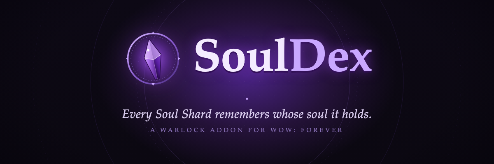
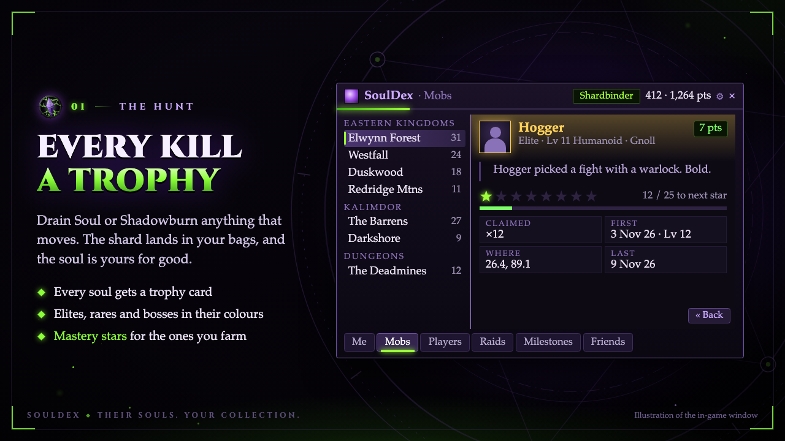
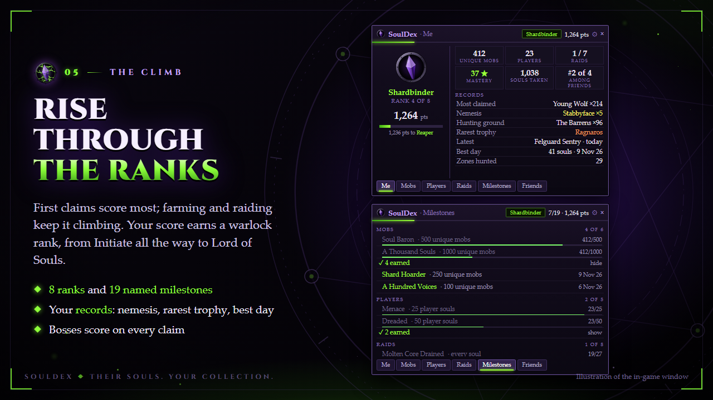

  

  
  
  
  

# SoulDex

**Their souls. Your collection.** A World of Warcraft: Forever addon for warlocks that turns
Soul Shard farming into a hunt: every shard that lands in your bags claims the mob
or player it came from for your dex. Score points, climb the warlock ranks from
Initiate to Lord of Souls, and outrank the other warlocks in your guild.

Type `/souldex` or `/dex` in game to open it.

## Features

### ◆ The hunt: every kill a trophy

Every creature you've drained, filed by zone and dungeon, in its rarity colour.
Click any soul for its trophy card: level and type, a one-line epitaph, its mastery
stars, how many times you claimed it, and when and where you took it first. Dungeon souls get their true names too (a boss drained mid-fight still
goes down as Unknown).

### ◆ The raids: drain every one

Every creature in every vanilla raid, from Zul'Gurub to Naxxramas. Unclaimed souls
stay `? ? ?`, bosses are marked before you claim them, and every raid has a
progress bar. The one hunt you can finish.

WoW: Forever's own raids, The Barrow Deeps and Hyjal Summit, are listed too. Their
rosters are still TBD: every soul you claim inside is kept and fills its slot when
the list ships.

### ◆ The trophies: every shard has a name

A popup and a sound for every new soul, coloured by what you claimed, with the
points it earned; mastery stars and rank-ups get popups of their own. Hover a Soul
Shard in your bags and its tooltip names the soul inside, with where and when you
took it. The name follows its shard through bags, the bank and relogs.

### ◆ The rivals: hunt players, outrank friends

Every player you've sharded, sorted by class. **Friends** is a leaderboard of
SoulDex users in your party, raid and guild, plus anyone you add by name. Browse
their dex read-only; what you lack is highlighted.

### ◆ The climb: rise through the ranks

First claims score most (1 normal, 5 elite, 10 rare or player, 25 boss). The mobs
you farm earn **mastery stars** at 10 to 1,000 claims and beyond, bosses score on
every claim, and players and rares pay a little again once a day. Your score earns
one of 8 warlock ranks, each with its own emblem; 19 named milestones track the
rest, and a **Me** tab shows your rank crest, your progress to the next rank and
your records (most-claimed mob, nemesis, rarest trophy, best day and more). Guild announcements are
optional and for big moments only.

### ◆ The grimoire: bend it to your will

Turn the popup, the sound and guild announcements on or off, or add a chat
line in your warlock's voice for every claim. SIZE scales the window and the
popups (60% to 160%). The settings are also a page under the game's Settings >
AddOns, and SoulDex has a key binding and an entry in the addon list by the
minimap.

The images are illustrations of the in-game window.

## Usage

`/dex` is short for `/souldex`: every command works with either one.

| Command | What it does |
|---------|--------------|
| `/souldex` or `/dex` | Open or close the SoulDex window |
| `/souldex options` or `/dex options` | Open the settings: the switches, and the size of the window and popups (also the gear on the window) |
| `/souldex add <name>` or `/dex add <name>` | Add a friend by name |
| `/souldex remove <name>` or `/dex remove <name>` | Remove a friend |
| `/souldex find <text>` or `/dex find <text>` | Look a soul up by name |
| `/souldex scale <60-160>` or `/dex scale <60-160>` | Set the window's size in percent |
| `/souldex reset` or `/dex reset` | Put the window back in the middle at normal size |
| `/souldex test` or `/dex test` | Show a sample popup |
| `/souldex version` or `/dex version` | Print the version you are running |

The new-soul popup, the sound, guild announcements, the login message and the
"Soul collected" tooltip line each have their own on/off switch in the settings, with the size of the
window and of the popups under them. The settings are also a page of the game's
own Settings window (Options > AddOns > SoulDex). `/dex help` lists the commands
in game.

A boss drained mid-fight gets its real name once the fight ends, if you keep it
targeted.

SoulDex is in the game's addon list by the minimap (click to open, right-click
for the settings), and you can bind a key to it under Options > Keybindings >
AddOns.

## Install

Install from CurseForge with your addon manager, or download the latest zip from
the [GitHub releases](https://github.com/ChrisMiho/SoulDex/releases) and unzip
the `SoulDex` folder into `World of Warcraft\_forever_\Interface\AddOns`. Restart
the game the first time; after that, `/reload` picks up updates.

## How it works

WoW: Forever hides the combat log from addons, so SoulDex reads your target
when you start Drain Soul (or cast Shadowburn) and names the next new shard
after it. When the game hides the target's name, the soul is counted as an
**Unknown soul** in that zone (no points, no popup). A shard SoulDex can't
match to a capture records nothing, so the dex never holds a wrong name.

Your dex is saved per character. Nothing leaves your game except guild
announcements (if you turn them on) and the small addon messages the Friends
tab exchanges with other SoulDex users.

## Bugs and ideas

Open an [issue on GitHub](https://github.com/ChrisMiho/SoulDex/issues). Say
what you did, what you expected and what happened instead, and include any Lua
error text.

## Development

You need Lua 5.1 tooling: `luarocks --lua-version 5.1 install luacheck` and
`luarocks --lua-version 5.1 install busted`. On Windows, run the `.sh` scripts
in Git Bash. On macOS, the build also needs `brew install bash`.

| Task | Command |
|------|---------|
| Lint | `luacheck .` |
| Unit tests | `busted` |
| Build, zip and install into the game | `scripts/build.sh` |
| Build and zip only | `scripts/build.sh --no-install` |

`scripts/build.sh` installs into the standard game folder on Windows or macOS;
set `WOW_ADDONS_DIR` to install somewhere else. When no game folder is found it
makes the zip and skips the install. The zip lands in `.release/`.

Behaviour is described in
[the design spec](docs/superpowers/specs/2026-11-10-souldex-design.md); code
and spec change together. Code conventions and repo layout are in
[`CLAUDE.md`](CLAUDE.md), which is written for both people and coding agents.
CI runs lint and tests on every push. Builds are published from `v*` tags, and
the tag's name decides who gets them:

| Tag | Goes to |
|-----|---------|
| `v1.5.0-alpha.1` | A GitHub pre-release only: untested builds |
| `v1.5.0-beta.1` | GitHub and CurseForge's beta channel: played by the author, fixes only from here |
| `v1.5.0` | Everyone: a beta that survived real play |

## Data

The raid creature lists (NPC IDs, names, raid membership and boss flag) are
generated from [Questie](https://github.com/Questie/Questie) v11.38.0
(`Database/Classic/classicNpcDB.lua`), which is licensed under GPL-3. See
`scripts/gen_raids.lua` and the header of `src/RaidData.lua`. Data is based on
Classic Era and may differ from WoW: Forever.

The names and boss counts of WoW: Forever's own raids come from Blizzard's
"World of Warcraft: Forever Raid Overview" and are hand-kept in
`src/ForeverData.lua`.

## Licence

Copyright (C) 2026 ChrisMiho. GNU General Public License v3.0; see `LICENSE`.
The raid data in `src/RaidData.lua` comes from Questie, also GPL-3; see Data above.
